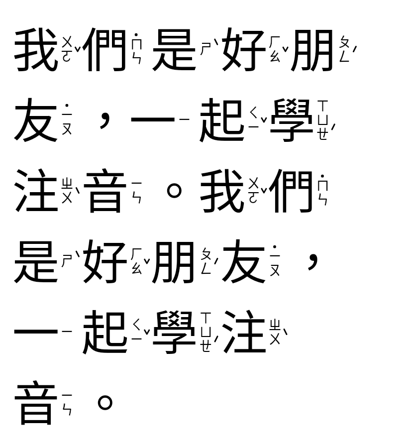
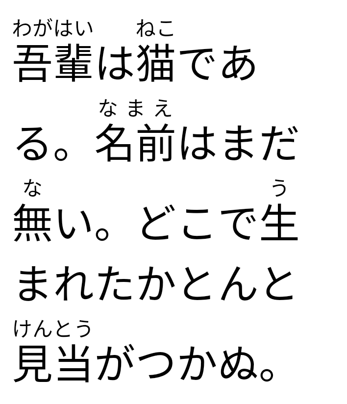
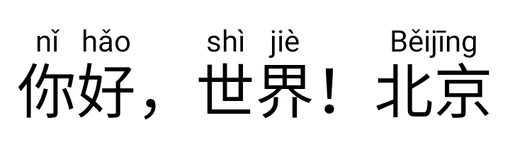

# RubyText

[](https://github.com/b84330808/RubyTextView/actions/workflows/ci.yml)

Ruby text for Jetpack Compose: Japanese furigana, Chinese Pinyin, and Zhuyin
(Bopomofo) set **vertically to the right of each character with tone marks**, the
way Taiwanese textbooks print it.

This is version 2 of [RubyTextView](https://github.com/b84330808/RubyTextView/tree/v1),
rewritten in Kotlin for Compose. The old Java `View` is on the
[`v1` branch](https://github.com/b84330808/RubyTextView/tree/v1); see
[Migrating from v1](#migrating-from-v1).

| Zhuyin on the right, with tone marks | Furigana and Pinyin |
| --- | --- |
|  | <br> |

<sub>Rendered on the JVM by the screenshot tests (Robolectric, Android 15 fonts). More in
[`rubytext-compose/src/test/screenshots`](rubytext-compose/src/test/screenshots).</sub>

## Features

- `RubyText` composable, plus a small `RubyString` model you can build in code.
- Markup parsers: `{漢字|かんじ}`, HTML `<ruby>`/`<rt>`/`<rp>`/`<rb>`, and Aozora Bunko
  `｜青空《あおぞら》`. The v1 `令|れい 和|わ` format is still read.
- Readings above (`Over`), below (`Under`), or to the right (`Right`). `Auto`, the
  default, puts Zhuyin on the right and everything else above.
- Right-side Zhuyin follows W3C [clreq §5.5.3](https://www.w3.org/TR/clreq/#positioning_of_zhuyin):
  symbols stacked in a column centered on the character, `ˊ ˇ ˋ` beside the upper
  right corner of the last symbol, the neutral-tone `˙` above the first symbol, and
  the same width for every syllable whether or not it has a tone mark. Tone marks are
  drawn as strokes, so their position does not depend on the font.
- Per-character or per-word alignment, and `space-around` spreading of short readings
  (JIS X 4051 style) that never spreads Latin words letter by letter.
- Line wrapping never separates a base from its reading. Wrap points come from the
  platform's line breaker (ICU on Android), so CJK punctuation rules apply.
- Follows the user's font scale, including Android 14's non-linear scaling, and keeps
  the reading size proportional to the base.
- RTL-safe: paragraphs are reordered with the Unicode bidi algorithm, CJK stays left
  to right, and `Start`/`End` alignment follows the paragraph direction.
- Accessibility: screen readers get the base text, or the base text with readings in
  parentheses (`readingsInSemantics = true`).
- Tap hit-testing through `onLayout` and `RubyLayout.segmentIndexAt(x, y)`.
- The core (`rubytext-core`) is pure Kotlin with no Android or dictionary dependency.
  Its layout engine takes a measurer interface, so other renderers can reuse it.

## Installation

Not published yet. Once `v2.0.0` is tagged it will be on JitPack:

```kotlin
// settings.gradle.kts
dependencyResolutionManagement {
    repositories {
        google()
        mavenCentral()
        maven("https://jitpack.io")
    }
}

// build.gradle.kts
dependencies {
    implementation("com.github.b84330808.RubyTextView:rubytext-compose:v2.0.0")
}
```

Maven Central (`io.github.b84330808:rubytext-compose`) is planned.

Requirements: minSdk 21, Compose UI 1.9 or newer.

## Usage

```kotlin
// Furigana
RubyText("{東京|とうきょう}へ{行|い}く", style = MaterialTheme.typography.bodyLarge)

// Zhuyin, one reading per character, placed on the right with tone marks
RubyText("{你好|ㄋㄧˇ ㄏㄠˇ}，{我們|ㄨㄛˇ ˙ㄇㄣ}{是|ㄕˋ}{朋友|ㄆㄥˊ ˙ㄧㄡ}。")

// Pinyin above
RubyText("{你好|nǐ hǎo}，{北京|Běijīng}")
```

### Markup

| Markup | Meaning |
| --- | --- |
| `{漢字\|かんじ}` | one reading for the whole base |
| `{東京\|とう\|きょう}` | one reading per character |
| `{你好\|ㄋㄧˇ ㄏㄠˇ}`, `{你好\|nǐ hǎo}` | whitespace-separated, one per character |
| `{你好\|ㄋㄧˇㄏㄠˇ}` | run-together Zhuyin is split per character when placed on the right |
| `{北京大学\|Peking University}` | word count differs from the character count: one reading |
| `\{ \} \\| \\` | literal characters; `\ ` is a space that does not split readings |

```kotlin
RubyString.parse("{漢字|かんじ}")
RubyString.fromHtml("<ruby>漢<rt>かん</rt>字<rt>じ</rt></ruby>")
RubyString.fromAozora("｜青空《あおぞら》と漢字《かんじ》")

val text = buildRubyString {
    ruby("東京", "とうきょう")
    append("と")
    ruby("你好", listOf("ㄋㄧˇ", "ㄏㄠˇ"))
}
```

`Pinyin.fromNumbered("ni3 hao3")` gives `nǐ hǎo`; `Zhuyin.parseSyllable("ㄏㄠˇ")` and
`Zhuyin.splitSyllables("ㄋㄧˇㄏㄠˇ")` help with Zhuyin data.

### Styling

```kotlin
RubyText(
    text = text,
    style = MaterialTheme.typography.headlineSmall,
    color = MaterialTheme.colorScheme.onSurface,
    rubyStyle = RubyStyle(
        position = RubyPosition.Auto,       // Over, Under, Right
        grouping = RubyGrouping.Character,  // or Word: keep the word together
        align = RubyAlign.SpaceAround,      // or Center
        fontSize = 0.5.em,                  // readings above/below
        zhuyinFontSize = 0.3.em,            // Zhuyin on the right (clreq's 3:10)
        color = MaterialTheme.colorScheme.primary,
    ),
    textAlign = TextAlign.Start,
    maxLines = Int.MAX_VALUE,
    readingsInSemantics = false,
    onLayout = { layout -> /* layout.segmentIndexAt(x, y) */ },
)
```

`RubyText` has no Material dependency, so pass your theme's text style and color.
Set `localeList` on the style (`LocaleList("ja-JP")`, `LocaleList("zh-TW")`) so the
right CJK font and line-breaking rules are used.

## Modules

| Artifact | What | License |
| --- | --- | --- |
| `rubytext-compose` | the `RubyText` composable (Android library) | Apache-2.0 |
| `rubytext-core` | `RubyString`, parsers, Zhuyin/Pinyin helpers and the layout engine; pure Kotlin, pulled in by `rubytext-compose` | Apache-2.0 |
| `rubytext-zh` | optional: Chinese to Zhuyin or Pinyin, offline, polyphones read by word | code Apache-2.0, reading tables **CC BY-SA 4.0** ([NOTICE](rubytext-zh/NOTICE.md)) |
| `rubytext-ja` | optional: Japanese furigana with [kuromoji](https://github.com/atilika/kuromoji) | Apache-2.0; depends on mecab-ipadic (NAIST license, [NOTICE](rubytext-ja/NOTICE.md)) |

The core has no dictionary dependency. The two annotators are separate so you only
take on their size and data licenses if you use them.

### Automatic readings

```kotlin
val zh = ChineseAnnotator()   // load once, off the main thread
RubyText(zh.annotate("我去銀行領錢，然後在路上行走。"))          // 銀行 ㄧㄣˊ ㄏㄤˊ, 行走 ㄒㄧㄥˊ ㄗㄡˇ
RubyText(zh.annotate("我去银行取钱", notation = ChineseNotation.Pinyin))

val ja = JapaneseAnnotator()
RubyText(ja.annotate("吾輩は猫である。"))
```

`ChineseAnnotator` splits Han text into dictionary words (fewest words, then most
frequent), so polyphonic characters get the reading of their word. It detects
Traditional (Taiwan readings) or Simplified (mainland readings) text, or takes
`ChineseStandard` explicitly. Its tables come from
[Ruby Everywhere](https://github.com/b84330808/ruby-everywhere) and are built from
McBopomofo, libtabe, CC-CEDICT and Unihan; if you redistribute the tables themselves,
CC BY-SA 4.0 applies to them. `JapaneseAnnotator` puts readings on kanji only and
leaves okurigana bare (取(と)り扱(あつか)い). Both give dictionary readings: names and
rare words can be wrong.

## Migrating from v1

v1 was a `TextView` subclass configured with `app:combinedText="令|れい 和|わ"`.

| v1 (`RubyTextView`) | v2 (`RubyText`) |
| --- | --- |
| `app:combinedText="令\|れい 和\|わ"` | `RubyText(RubyString.fromLegacy("令\|れい 和\|わ"))`, or the new markup `"{令\|れい}{和\|わ}"` |
| `setCombinedText(...)` | pass a new `RubyString` |
| `app:rubyTextSize` / `setRubyTextSize` | `RubyStyle(fontSize = ...)` |
| `app:rubyTextColor` / `setRubyTextColor` | `RubyStyle(color = ...)` |
| `app:spacing` / `setSpacing` | `RubyStyle(gap = ...)` |
| `android:textSize`, `android:textColor` | `fontSize`, `color` or `style` |

In XML layouts, host the composable in a `ComposeView`. The v1 artifact
(`me.weilunli.views:rubytextview:1.3.1`) was on Bintray, which has shut down; the
source stays on the [`v1` branch](https://github.com/b84330808/RubyTextView/tree/v1).

## Building

```sh
./gradlew :rubytext-core:test             # pure Kotlin, no Android SDK needed
./gradlew :rubytext-core:renderPreviews   # draws layouts to rubytext-core/build/previews with java.awt
./gradlew build                           # everything; needs the Android SDK
./gradlew :rubytext-compose:recordRoborazziDebug   # JVM screenshots, no emulator
```

Without an Android SDK, only `rubytext-core` is included in the build.

## 繁體中文

RubyText 是 Jetpack Compose 的注音／拼音／振り仮名元件，也是 RubyTextView 的 v2 版。
注音預設照課本的排法：直排在每個字的右邊，聲調符號放在最後一個注音符號的右上方，
輕聲的「˙」放在最上面，沒有聲調的字也保留相同寬度（依 W3C《中文排版需求》§5.5.3）。

```kotlin
RubyText("{你好|ㄋㄧˇ ㄏㄠˇ}，{我們|ㄨㄛˇ ˙ㄇㄣ}{是|ㄕˋ}{朋友|ㄆㄥˊ ˙ㄧㄡ}。")
RubyText("{你好|nǐ hǎo}")   // 拼音放在上方
```

換行時字和注音不會被拆開；字級跟著系統字體大小縮放。另有選用的 `rubytext-zh`，
可離線把中文自動標上注音或拼音，破音字依詞判斷（銀行／行走）；它的讀音表採 CC BY-SA 4.0。
舊版 Java View 保留在 `v1` 分支。

## 日本語

RubyText は Jetpack Compose 用のルビ（振り仮名）表示コンポーネントで、RubyTextView の
v2 です。`{漢字|かんじ}` 記法、HTML の `<ruby>`、青空文庫の `｜青空《あおぞら》` を読み込めます。
親文字とルビは改行で分かれません。モノルビ（`{東京|とう|きょう}`）は文字ごとに、
グループルビは語全体に配置され、短いルビは JIS X 4051 風に均等に配置されます。
別モジュールの `rubytext-ja` を使うと、kuromoji で振り仮名を自動で付けられます。

```kotlin
RubyText("{吾輩|わがはい}は{猫|ねこ}である。", style = TextStyle(localeList = LocaleList("ja-JP")))
```

## License

```
Copyright 2019-2026 Wei-Lun Li

Licensed under the Apache License, Version 2.0 (the "License");
you may not use this file except in compliance with the License.
You may obtain a copy of the License at

   http://www.apache.org/licenses/LICENSE-2.0

Unless required by applicable law or agreed to in writing, software
distributed under the License is distributed on an "AS IS" BASIS,
WITHOUT WARRANTIES OR CONDITIONS OF ANY KIND, either express or implied.
See the License for the specific language governing permissions and
limitations under the License.
```
